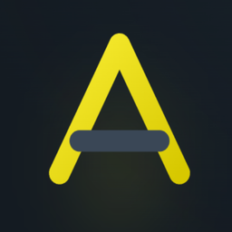

# ArmotuSitio IDE



Distribución personalizada de Code - OSS para trabajar con **ArmotuSitio 2.0** y **RedEvent** en Windows 11 x64.
Conserva el editor, terminal, Git, depurador y APIs de extensiones, e incorpora herramientas para ambos proyectos.

[Repositorio](https://github.com/Drako01/armotusitio-ide) · [Upstream](https://github.com/microsoft/vscode) · [Licencia](LICENSE.txt)

## Estado actual

Las personalizaciones están incorporadas en `main`.
La compilación de desarrollo fue probada localmente, incluido el logo real en la bienvenida.
Existen comandos para generar el instalador por usuario y el ZIP de Windows x64.
La compilación local no publica una release automáticamente.
Las descargas publicadas, cuando existan, estarán en [Releases](https://github.com/Drako01/armotusitio-ide/releases).
La prueba del instalador actual en una máquina limpia y del ciclo de actualización sigue pendiente.
El alcance completo Enterprise AAA del pedido original no se considera terminado.

## Funciones disponibles

| Área | Implementación actual |
| --- | --- |
| Identidad | Nombre, logo real, iconos, bienvenida y temas ArmotuSitio Dark y Light |
| Proyectos | Detección de ArmotuSitio 2.0 y RedEvent y sus comandos de Harness |
| Harness de RedEvent | Tarea libre, preguntas, revisión del plan y ejecución con el Harness nativo |
| Actividad | Tarea actual, progreso nativo cada 3 segundos y actualización manual mediante un ícono |
| Historial | Hasta 20 tareas por proyecto, duración, resultados y persistencia por workspace |
| Notificaciones | Avisos configurables al finalizar tareas del IDE y acceso al historial |
| Repetición | Repetir `check`, `verify` y `test` con confirmación y bloqueo de duplicados del IDE |
| Chat Harness | Comandos explícitos para consultar el Harness y ejecutar verificaciones |
| MCP ArmotuSitio | Consultar proyectos y tareas de Work Management; crear, mover y comentar con confirmación |
| Herramientas | Inventario de contexto, listado y creación de worktrees, consultas GitHub y apertura de n8n |
| Agentes | Envío confirmado de tareas a CLI de Codex o Claude instaladas y autenticadas |
| Extensiones | Catálogo configurado con Open VSX e instalación de VSIX compatibles |
| Distribución | Compilación local, instalador Windows x64 por usuario y ZIP de la aplicación completa |
| Actualizaciones | Herramientas locales para detectar upstream, preparar candidatos y distribuir releases propias |

El progreso externo de RedEvent se consulta cada 15 segundos mediante su comando nativo.
En ArmotuSitio, la actividad e historial cubren las tareas iniciadas desde el IDE.
Las tareas sin resultado conocido después de reiniciar se muestran como tales.
El chat propio no llama a modelos de IA ni reemplaza al orquestador de cada proyecto.

## Preparar el código fuente

Requisitos principales para compilar en Windows:

- Git y PowerShell.
- Node.js con la versión fijada en [.nvmrc](.nvmrc), y npm.
- Python 3 y herramientas de C++ compatibles con las dependencias nativas.
- Visual Studio Build Tools 2022 con Desktop development with C++, MSVC v143 y bibliotecas Spectre requeridas.
- Windows SDK, incluido `signtool.exe` para el empaquetado.
- Espacio y memoria suficientes para compilar Code - OSS y sus extensiones.

Cloná el repositorio en una ruta corta:

```powershell
git clone --branch main https://github.com/Drako01/armotusitio-ide.git
cd armotusitio-ide
Get-Content .nvmrc
node scripts/ats-windows-preflight.mts
npm install
```

Ejecutá los comandos en orden y continuá solo si cada paso termina correctamente.
Si ya tenés las dependencias preparadas, no hace falta reinstalarlas para cada compilación.
El editor utiliza **npm**; los proyectos abiertos pueden requerir sus propias versiones de pnpm y otros runtimes.
Para problemas de herramientas nativas, consultá la [guía de Windows](docs/armotusitio-ide/WINDOWS-BUILD.md).

## Compilar y probar con code.bat

Cerrá las ventanas anteriores de ArmotuSitio IDE.
Desde la raíz del checkout, actualizá `main` y compilá:

```powershell
git switch main
git pull --ff-only origin main
node scripts/ats-build-dev.mts
```

Cuando aparezca `Development build ready`, abrí el IDE:

```powershell
.\scripts\code.bat --new-window
```

El comando actualiza `out`, las extensiones integradas, Copilot y la extensión propia de ArmotuSitio.
También verifica que la bienvenida compilada incluya el logo real.
`code.bat` carga esa salida de desarrollo; no se compila el archivo `.bat`.
Si `out` ya existe, ejecutar solamente `code.bat` no garantiza recompilar los cambios.
El empaquetador de Windows genera otra salida y no actualiza ese `out` de desarrollo.

Mantené el checkout en `main`, sin cambios versionados, y no cambies código o commits durante la compilación.
La receta completa está en [compilación de desarrollo](scripts/README-ATS-DEVELOPMENT.md).

## Generar el instalador y el ZIP

Con `main` actualizado, sin cambios versionados ni otra compilación activa:

```powershell
node scripts/ats-build-all.mts
```

Cuando el comando completo termine correctamente, generá los artefactos:

```powershell
node scripts/ats-autoupdate.mts artifacts
```

| Resultado | Ruta desde la raíz del checkout |
| --- | --- |
| Aplicación empaquetada | `../ArmotuSitio-IDE-win32-x64/` |
| Instalador intermedio | `.build/win32-x64/user-setup/VSCodeSetup.exe` |
| Instalador con nombre de ArmotuSitio, ZIP, manifiesto firmado y hashes | `.build/releases/` |

El paso `artifacts` requiere un build validado del mismo commit y la clave privada local de distribución.
La receta completa incluye Windows, desarrollo y Linux; requiere Docker Desktop con contenedores Linux.
Linux usa un volumen de trabajo por arquitectura, `ats-linux-x64-work` y `ats-linux-arm64-work`.
Las dependencias se reinstalan solo cuando cambian los lockfiles, la versión de Node o los scripts de instalación.
Cada build deja su registro con tiempos por etapa en `.build/ats-linux/<commit>/linux-<arch>.log`.
Para automatizar una release de la versión actual, ejecutá [release.sh](release.sh) desde Git Bash en Windows.
El script calcula r1 o la siguiente revisión publicada de esa versión y reutiliza las recetas existentes.

```bash
./release.sh --plan
./release.sh
```

Desde PowerShell, usá `& 'C:\Program Files\Git\bin\bash.exe' .\release.sh`.
Requiere main limpio y actualizado, Node Windows x64 >=24.18, Docker Linux, `gh` y la clave existente.
La ejecución normal puede crear y mergear un PR acotado de metadata antes de validar, compilar, firmar y publicar.
`--plan` no modifica archivos ni Git; `--no-publish` permite detenerse antes de publicar para una prueba manual.
La guía manual anterior se conserva localmente en `plans/RELEASE-R4.md`, ignorada por Git.

El manifiesto se firma con Ed25519; esto no equivale a firmar el instalador con un certificado de editor de Windows.
Las claves privadas no se incluyen en el repositorio ni se comparten con los compañeros.
Para compartir sin instalar, usá el ZIP completo; el EXE solo no contiene todos los archivos necesarios.
Las extensiones personales, proyectos, bases de datos y sesiones de autenticación no se incorporan al instalador.

Si aparece `Source changed during packaging`, repetí el empaquetado desde un commit fijo y limpio.
Que Inno Setup haya creado un EXE no sustituye la validación final del comando.
Consultá [distribución](docs/armotusitio-ide/DISTRIBUTION.md) para los detalles de entrega.

## Harness, chat y gestión de tareas

Abrí la carpeta raíz de uno o ambos proyectos:

- **ArmotuSitio 2.0:** `package.json` con nombre `armotusitio-next` y carpeta `harness/`.
- **RedEvent:** `package.json` con nombre `redevent` y carpeta `.harness/`.

Desde `Ctrl+Shift+P`, ejecutá **ArmotuSitio: Inicio** o **ArmotuSitio: Chat Harness**.

Para ejecutar una tarea libre en RedEvent:

1. Abrí **ArmotuSitio: Inicio** y elegí el proyecto y la IA.
2. Escribí el cambio y el resultado esperado. Elegí **Preparar tarea**.
3. Respondé las preguntas que indique el Harness y revisá el plan.
4. Elegí **Ejecutar con Harness** para comenzar el trabajo.
5. Seguí los pasos y el progreso; usá el ícono de refrescar para consultar el estado manualmente.
6. Revisá los cambios y los detalles al finalizar. Una tarea interrumpida requiere elegir **Reanudar tarea**.

Las herramientas adicionales están en **Herramientas del proyecto y actividad anterior**, agrupadas por propósito.
Cada herramienta explica su efecto. Las operaciones que ejecutan verificaciones o modifican estado piden confirmación.
El flujo nuevo de tareas libres requiere los comandos de ciclo de vida del Harness de RedEvent.
La integración existente de ArmotuSitio conserva sus comandos; no se presupone el mismo contrato de ejecución.

El chat propio funciona sin iniciar sesión en Copilot.
El participante `@harness` también se registra en el chat nativo cuando hay un proveedor predeterminado disponible.
Una tarea libre enviada al chat abre un borrador en el panel para preparar y revisar su plan.

```text
@harness comandos
@harness estado
@harness check redevent
@harness proyectos
@harness tareas RED
@harness tarea RED-001-219
@harness crear RED Revisar autenticación
@harness comentar RED-001-219 Revisar el resultado del test
```

Las consultas MCP usan el servidor existente de Work Management y los permisos de tu agente.
Para autenticación, el IDE utiliza primero la clave guardada en SecretStorage y después `ATS_MCP_TOKEN` heredada.
Podés guardar la clave con **ArmotuSitio: Configurar clave MCP**, mediante un diálogo protegido.
No pegues claves en el chat ni las guardes en archivos versionados.
Las modificaciones requieren contexto actual, herramienta autorizada y confirmación explícita.
Cancelar una consulta no revierte un cambio que ya haya aceptado el servidor.

Los ajustes `atsHarness.enabled`, `atsHarness.notifications` y `atsHarness.mcp.enabled` controlan cada integración.
Consultá los comandos y límites en la [guía de la extensión](extensions/armotusitio-ide/README.md).

## Instalar extensiones y herramientas opcionales

La búsqueda de extensiones usa Open VSX.
La disponibilidad depende de ese catálogo y de la compatibilidad de cada extensión con el editor.
El [perfil enfocado](docs/armotusitio-ide/extensions.focused.json) conserva la selección para PHP, Next.js y Go.
El [inventario original](docs/armotusitio-ide/extensions.snapshot.json) permite recuperar otras extensiones.
Estos inventarios no implican que todas esas extensiones estén incluidas en el instalador.

Las funciones opcionales requieren herramientas propias:

- `gh` autenticada para consultar PRs y ejecuciones de GitHub.
- `codex` o `claude` instaladas y autenticadas para enviar tareas a esas CLI.
- n8n accesible mediante `atsHarness.n8nUrl`.
- PHP, Go, Node/pnpm y motores de bases de datos según el proyecto abierto.

## Actualizaciones y GitHub Actions

El IDE consulta las releases propias de ArmotuSitio; no instala directamente los binarios de Microsoft.
La incorporación de upstream requiere preparar un candidato, revisar, validar, compilar y publicar una release propia.
Detectar una versión nueva de VS Code no equivale a tener una actualización de ArmotuSitio lista para instalar.
La actualización entre dos instalaciones y la prueba en una máquina limpia siguen pendientes de validación.

GitHub Actions está desactivado a nivel del repositorio por decisión del propietario.
Los comandos de compilación documentados son locales y no necesitan ejecutar workflows.
No habilites Actions para compilar o publicar este fork sin autorización del propietario.

Consultá [el flujo de actualización](docs/armotusitio-ide/AUTOUPDATE.md) y [el plan pendiente](TODO-AUTOUPDATE.md).

## Validación y pendientes

Para comprobar la extensión y la receta de desarrollo sin construir todo el producto:

```powershell
npm test --prefix extensions/armotusitio-ide
npm run check --prefix extensions/armotusitio-ide
node --test scripts/ats-build-dev.test.mts
```

Los tests focalizados no sustituyen la compilación ni las pruebas del producto empaquetado.
Siguen pendientes el Mission Control multiagente completo, la planificación automática y el Context Engine avanzado.
También quedan por ampliar Quality Guardian, Database Center y la gestión visual de GitHub, worktrees y n8n.
Linux y macOS no se presentan como plataformas verificadas de esta distribución.

Para contribuir, consultá [CONTRIBUTING.md](CONTRIBUTING.md).
El código original conserva su licencia MIT; los servicios y extensiones de terceros tienen sus propias condiciones.
